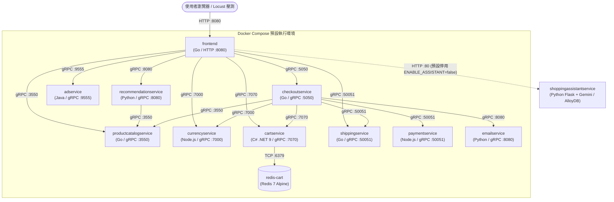
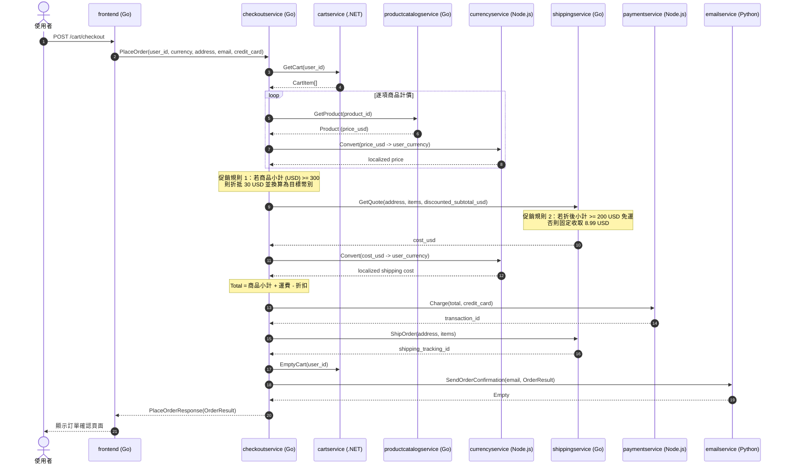

# 專案架構文件（Online Boutique / `ai-software-dev-demo`）

本文件說明 **Online Boutique**（本專案 Compose 名稱：`online-boutique-reppit`）之系統架構、多語言微服務拓撲、gRPC 通訊合約、核心業務流程、擴充商業邏輯，以及 CI/CD 與 AI 輔助開發基礎設施。

---

## 1. 系統概觀

Online Boutique 是一個多語言容器化微服務電子商務系統，透過 **Docker Compose** 進行本機編排與部署。系統採用 **HTTP 對外、內部全 gRPC** 的架構設計，並以 **Redis** 作為購物車資料儲存後端。

除了原生的線上商店核心功能外，本專案亦包含：
- **客製化電商促銷規則**：滿 USD \$300 折 USD \$30（`spend300get30off`）與折後滿 USD \$200 免運費（`free_shipping`）。
- **自動化 CI/CD 與品質把關**：GitHub Actions 針對 `emailservice` 進行單元測試、gRPC 健康檢查與 SonarQube Cloud 靜態掃描，並整合 Gemini AI 自動進行 Pull Request 審查。
- **AI 軟體開發教學工作流**：於 `prompts/` 與 `research/` 保存五階段開發流程（Research → Propose → Plan → Implement → Review）與設計文件。

---

## 2. 系統架構圖

### 2.1 微服務拓撲與通訊協定



### 2.2 結帳流程時序圖（Checkout Flow）



---

## 3. 服務清單與技術棧

### 3.1 Docker Compose 預設啟動服務（共 11 個容器）

| 服務名稱 | 語言 / 執行環境 | 對內埠號 | 對外映射 | 職責說明 | 原始碼路徑 |
| :--- | :--- | :--- | :--- | :--- | :--- |
| `frontend` | Go 1.23 (`gorilla/mux`) | HTTP `:8080` | `127.0.0.1:8080` | 網站入口與 HTML 渲染、管理 Session/幣別 Cookie、串接各後端 gRPC 服務 | `src/frontend/` |
| `checkoutservice` | Go | gRPC `:5050` | - | 結帳編排中心：彙整購物車、套用滿額折扣、計算運費、扣款、出貨與寄信 | `src/checkoutservice/` |
| `productcatalogservice` | Go | gRPC `:3550` | - | 從 `products.json` 讀取商品目錄，提供列表、單品查詢與關鍵字搜尋 | `src/productcatalogservice/` |
| `cartservice` | C# (.NET 9.0 / ASP.NET Core) | gRPC `:7070` | - | 購物車 CRUD（新增、讀取、清空），預設連線至 `redis-cart`（支援 Spanner / AlloyDB / 記憶體快取切換） | `src/cartservice/` |
| `redis-cart` | Redis 7 Alpine | TCP `:6379` | - | 儲存使用者購物車資料（無持久化模式：`--save "" --appendonly no`，附帶 `redis-cli ping` 健康檢查） | `compose.yaml` |
| `currencyservice` | Node.js (`@grpc/grpc-js`) | gRPC `:7000` | - | 依據 `data/currency_conversion.json`（歐洲央行匯率資料）進行多幣別轉換 | `src/currencyservice/` |
| `shippingservice` | Go | gRPC `:50051` | - | 計算運費報價（`GetQuote`）與產生模擬物流追蹤編號（`ShipOrder`） | `src/shippingservice/` |
| `paymentservice` | Node.js (`@grpc/grpc-js`) | gRPC `:50051` | - | 模擬信用卡格式驗證（`simple-card-validator`）與扣款，回傳交易 UUID | `src/paymentservice/` |
| `emailservice` | Python (gRPC + Jinja2) | gRPC `:8080` | - | 訂單確認信服務，目前以 `DummyEmailService` 模式記錄日誌（含 `templates/confirmation.html` 範本） | `src/emailservice/` |
| `recommendationservice` | Python (gRPC) | gRPC `:8080` | - | 向 `productcatalogservice` 取得目錄並過濾已選商品後，隨機推薦最多 5 項商品（UI 顯示最多 4 項） | `src/recommendationservice/` |
| `adservice` | Java (JDK 19/21/25 + Gradle + Netty) | gRPC `:9555` | - | 依據頁面上下文關鍵字（`context_keys`）回傳對應文字廣告 | `src/adservice/` |

### 3.2 選用 / 非預設啟動服務

| 服務名稱 | 語言 / 技術 | 狀態 | 職責說明 | 原始碼路徑 |
| :--- | :--- | :--- | :--- | :--- |
| `loadgenerator` | Python / Locust | 未加入預設 `compose.yaml` | 模擬真實使用者的瀏覽、切換幣別、加入購物車與結帳負載測試 | `src/loadgenerator/` |
| `shoppingassistantservice` | Python (Flask + LangChain + Gemini + AlloyDB VectorStore) | 預設停用（`ENABLE_ASSISTANT: "false"`） | 結合 Gemini 視覺模型與 AlloyDB 向量檢索的 AI 購物助理（需 GCP Secret Manager 與 AlloyDB 環境） | `src/shoppingassistantservice/` |

---

## 4. API 與資料契約設計

### 4.1 統一 Protobuf 合約（`protos/demo.proto`）

所有核心微服務皆以 `protos/demo.proto`（`package hipstershop`）為共同介面契約，並各自透過 `genproto.sh`、Gradle Protobuf Plugin 或執行期動態載入（Node.js `@grpc/proto-loader`）維持介面一致：

| Service | RPC 方法 | 說明 |
| :--- | :--- | :--- |
| `CartService` | `AddItem`, `GetCart`, `EmptyCart` | 購物車項目寫入、查詢與清空 |
| `ProductCatalogService` | `ListProducts`, `GetProduct`, `SearchProducts` | 商品清單、依 ID 查詢與關鍵字搜尋 |
| `CurrencyService` | `GetSupportedCurrencies`, `Convert` | 取得支援之 ISO 4217 幣別代碼與金額換算（`Money` 使用 `units` + `nanos` 精確表示） |
| `ShippingService` | `GetQuote`, `ShipOrder` | 依據商品折後小計計算運費、產生出貨追蹤碼 |
| `PaymentService` | `Charge` | 信用卡扣款並回傳 `transaction_id` |
| `EmailService` | `SendOrderConfirmation` | 傳送訂單結果至確認信服務 |
| `CheckoutService` | `PlaceOrder` | 執行完整下單交易編排 |
| `RecommendationService` | `ListRecommendations` | 依購物車或瀏覽商品回傳推薦商品 ID |
| `AdService` | `GetAds` | 依上下文關鍵字回傳廣告項目 |

此外，後端 gRPC 服務皆實作標準 `grpc.health.v1.Health`（`Check` / `Watch`）介面供健康檢查使用。

### 4.2 Frontend HTTP 路由（`src/frontend/main.go`）

- `GET /`：首頁商品列表與幣別切換
- `GET /product/{id}`：單一商品詳情、推薦商品與上下文廣告
- `GET /cart`、`POST /cart`、`POST /cart/empty`：查看購物車、加入商品與清空購物車
- `POST /setCurrency`：更新使用者偏好幣別 Cookie（`shop_currency`，預設 `USD`）
- `POST /cart/checkout`：呼叫 `CheckoutService.PlaceOrder` 完成結帳
- `GET /logout`：清除使用者 Session Cookie
- `GET /assistant`、`POST /bot`：AI 購物助理介面與後端轉發（視 `ENABLE_ASSISTANT` 開關）
- `GET /_healthz`、`GET /product-meta/{ids}`、`GET /static/*`：健康檢查、商品中繼查詢與靜態資源

### 4.3 本專案擴充商業邏輯

相較於標準版 Online Boutique，本專案在計算金額與運費時加入了兩項促銷規則：

1. **滿額折扣（Spend \$300 Get \$30 Off）**
   - 實作位置：`src/frontend/handlers.go`（`viewCartHandler` 顯示試算）與 `src/checkoutservice/main.go`（`prepareOrderItemsAndShippingQuoteFromCart` 實際計價）。
   - 規則：以美元（USD）計算購物車商品小計，若小計 ≥ \$300 USD，則折抵 \$30 USD，換算為使用者所選幣別後寫入 `OrderResult.discount` 並於總金額中扣除。
2. **滿額免運（Free Shipping ≥ \$200 USD）**
   - 實作位置：`src/shippingservice/main.go`（`GetQuote`），搭配 `protos/demo.proto` 新增的 `GetQuoteRequest.items_subtotal_usd` 欄位。
   - 規則：傳入套用滿額折扣後的 `discountedSubtotalUSD`；若折後小計 ≥ \$200 USD，運費為 \$0 USD，否則收取固定運費 \$8.99 USD（`src/shippingservice/quote.go`）。

---

## 5. 可觀測性與跨切面設計

- **分散式追蹤（OpenTelemetry）**：Go、Node.js 與 Python 服務內建 OTLP gRPC Exporter 支援（透過 `ENABLE_TRACING=1` 與 `COLLECTOR_SERVICE_ADDR` 啟用），並在 `compose.yaml` 預設關閉（`ENABLE_TRACING: "0"`）。
- **效能剖析（Cloud Profiler）**：多數服務包含 Google Cloud Profiler 初始化邏輯，於本機 `compose.yaml` 預設以 `DISABLE_PROFILER: "1"` 或 `ENABLE_PROFILER: "0"` 停用。
- **結構化日誌**：各服務輸出 JSON 格式日誌至 `stdout`（Go 使用 `logrus`、Node.js 使用 `pino`、Python 使用 `python-json-logger`、Java 使用 `log4j2`）。
- **容錯與測試輔助**：`productcatalogservice` 支援 `EXTRA_LATENCY` 環境變數注入人為延遲，以及透過 `SIGUSR1` / `SIGUSR2` 訊號控制目錄熱重載。

---

## 6. CI/CD、程式碼品質與開發輔助設施

### 6.1 GitHub Actions 工作流程（`.github/workflows/`）

| Workflow 檔案 | 觸發條件 | 主要執行內容 |
| :--- | :--- | :--- |
| `email-ci.yaml` | `push` (`main`) 或 `pull_request` 修改 `src/emailservice/**`（及手動觸發） | 建置 `emailservice` Docker 映像 → 執行 `pytest tests/test_email.py` 單元測試 → 啟動容器並以 Python gRPC Client 驗證 `Health.Check` 回傳 `SERVING` |
| `email-sonar.yml` | `push` (`main`) 修改 `src/emailservice/**` 或 `sonar-project.properties`（及手動觸發） | 執行 SonarQube Cloud 掃描（`sonar.qualitygate.wait=true`），並呼叫 SonarCloud API 檢查 `OPEN`/`CONFIRMED` 之 `HIGH`/`BLOCKER` 問題（超過 0 筆即失敗） |
| `ai-review.yml` | `pull_request` (`opened`, `synchronize`, `reopened`) | 讀取 PR 變更的 Diff（上限 20,000 字元），呼叫 Gemini API（`gemini-3.5-flash-lite`）生成繁體中文審查摘要、潛在問題與改善建議並張貼至 PR 留言 |

### 6.2 靜態分析設定（`sonar-project.properties`）

- 目前設定聚焦掃描 `src/emailservice`（關閉自動偵測 `sonar.scanner.autoconfig.enabled=false`）。
- 測試目錄指定為 `src/emailservice/tests`，並於分析範圍中排除測試檔與自動產生的 Protobuf 檔案（`*_pb2.py`、`*_pb2_grpc.py`）。

### 6.3 AI 輔助開發規範與文件（`AGENTS.md`、`prompts/`、`research/`）

- `AGENTS.md`：定義各語言程式碼風格（Go `gofmt`、C#/Python 4 空格、JS 2 空格、Java `google-java-format`）、單元測試執行方式與 Commit/PR 規範。
- `prompts/`：提供五階段開發提示詞與設計文件範本（`1-research_chinese.md` 至 `5-review_chinese.md`、`design_doc_template.md`）。
- `research/`：收錄過往需求研究與設計決策紀錄（`free_shipping/`、`spend300get30off/`、`ci-cd-test/`、`discount_code/`）。

---

## 7. 儲存庫目錄結構

```text
.
├── .github/workflows/          # GitHub Actions CI、SonarQube 掃描與 AI PR Review
├── docs/                       # 專案說明文件、需求規範與架構截圖
├── prompts/                    # AI 協作開發五階段提示詞與設計文件範本
├── protos/                     # 共用 gRPC / Protobuf 合約 (demo.proto 與 health.proto)
├── research/                   # 功能研究筆記、提案與設計文件
├── src/                        # 各微服務原始碼與 Dockerfile
│   ├── adservice/              # Java 廣告服務
│   ├── cartservice/            # C# (.NET 9) 購物車服務與單元測試
│   ├── checkoutservice/        # Go 結帳編排服務
│   ├── currencyservice/        # Node.js 匯率換算服務
│   ├── emailservice/           # Python 訂單確認信服務與 pytest 測試
│   ├── frontend/               # Go 前端網頁伺服器與模板
│   ├── loadgenerator/          # Python/Locust 負載產生器
│   ├── paymentservice/         # Node.js 模擬金流服務
│   ├── productcatalogservice/  # Go 商品目錄服務與商品資料 (products.json)
│   ├── recommendationservice/  # Python 商品推薦服務
│   ├── shippingservice/        # Go 運費報價與物流追蹤服務
│   └── shoppingassistantservice/ # Python AI 購物助理服務（預設未啟用）
├── AGENTS.md                   # 開發與測試指南
├── compose.yaml                # 本機 Docker Compose 服務編排設定
├── README.md                   # 專案簡介與快速啟動指南
└── sonar-project.properties    # SonarQube Cloud 掃描設定
```
